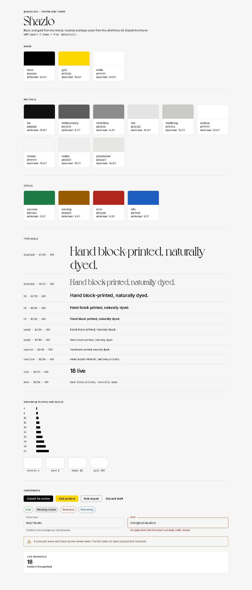

# @shazlo/ui

Shared MUI theme and design tokens for every Shazlo app: brand black `#000` and gold `#FFD700`, Voyage for display text, Inter for everything else. Neutrals, spacing, radii and the type scale match the vendor portal and Shazlo-One wireframes.

## Use

```ts
import { CssBaseline, ThemeProvider } from '@mui/material'
import { theme } from '@shazlo/ui'

<ThemeProvider theme={theme}>
  <CssBaseline />
  <App />
</ThemeProvider>
```

Add `"@shazlo/ui": "*"` to the app's `dependencies`; npm workspaces link it. The package ships TypeScript source, so Vite and `tsc` read it directly with no build step. Apps also need its peer dependencies: `@mui/material` 9, `@emotion/react`, `@emotion/styled` and `react` 19.

| Export | What it is |
|---|---|
| `theme` | The default MUI theme |
| `createShazloTheme({ voyage?, overrides? })` | Same theme, with Voyage `@font-face` rules and/or deep-merged overrides |
| `tokens` (`brand`, `neutral`, `status`, `fontFamily`, `typeScale`, `space`, `radius`, `shadow`) | Raw values for anything outside MUI |
| `voyageFontFaces({ baseUrl })` | The `@font-face` CSS for Voyage, for apps that self-host it |
| `contrastRatio(a, b)` | WCAG contrast ratio, used by the tests |

Extra `Typography` variants: `display1` (Voyage 64), `display2` (Voyage 40), `stat` (28) and `mono` (JetBrains Mono 12).

## Colour rules

- Gold is an accent and a button fill. Text on gold is always black (15:1); white on gold fails contrast.
- Status colours (`success`, `warning`, `error`, `info`) all pass WCAG AA as text on white. Status is never shown by colour alone; pair it with an icon or label.
- The tests check these ratios, so a token change that breaks contrast fails CI.

## Fonts

- **Voyage** (Violaine & Jérémy, vj-type.com) is a commercial typeface. Its web licence is not confirmed, so the files are **not** in this package. To use it, host `voyage-regular.otf` and `voyage-bold.otf` and pass their folder: `createShazloTheme({ voyage: { baseUrl: '/fonts' } })`. Without it, display text falls back to Instrument Serif, then Georgia.
- **Inter** and **JetBrains Mono** are open-source (SIL OFL). Apps load them, for example from Google Fonts or `@fontsource`.

## Demo

```bash
npm run demo -w @shazlo/ui
```

It shows every token and the themed MUI components. It serves the Voyage files from the legacy site's `app/public` folder, where they are hosted today.



## Scripts

`npm run typecheck -w @shazlo/ui` and `npm test -w @shazlo/ui`; both also run from the repo root and in the apps CI workflow.
